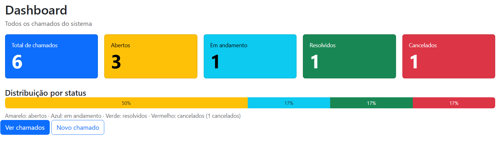
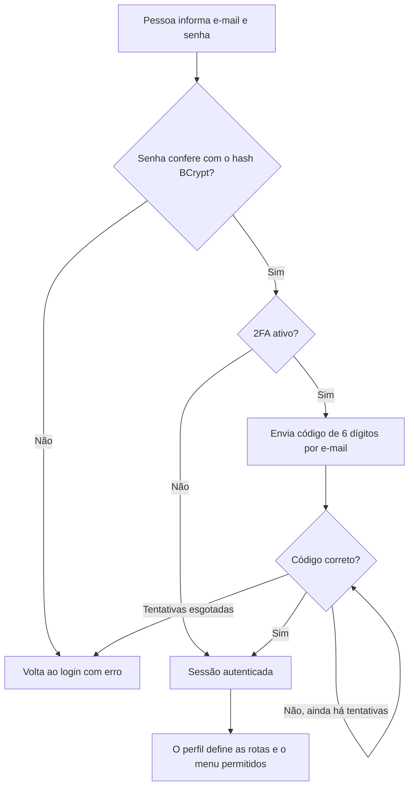

# Thindesk – Sistema de Login Seguro

Sistema de autenticação e autorização em **Java Spring Boot**, **Thymeleaf** e **MongoDB Atlas**, com cadastro, login, logout, três perfis de acesso, recuperação de senha e verificação em duas etapas (2FA).

O núcleo de segurança (usuários, perfis, senhas, 2FA, recuperação) é **independente do assunto do sistema**. O domínio de exemplo é um *help desk* (chamados, clientes e horários de atendimento), mantido separado da parte de segurança.

## Versão e versionamento

**Versão atual: `1.1.0-beta`**

O projeto segue o [Versionamento Semântico (SemVer)](https://semver.org/lang/pt-BR/), no formato:

```
MAJOR.MINOR.PATCH-etiqueta      ex.: 1.1.0-beta
```

| Parte | Quando muda |
|---|---|
| **MAJOR** | Mudança que quebra a compatibilidade (ex.: troca da estrutura do banco) |
| **MINOR** | Funcionalidade nova que não quebra o que já existia |
| **PATCH** | Correção de erro, sem funcionalidade nova |
| **etiqueta** | Estágio da versão: `alpha` (inicial), `beta` (funcional, em testes), `rc` (candidata a final). Sem etiqueta = estável |

Cada versão é marcada no Git com uma tag no formato `vMAJOR.MINOR.PATCH-etiqueta` (ex.: `v1.1.0-beta`), e o mesmo número fica no `pom.xml`.

| Versão | Conteúdo |
|---|---|
| `1.0-alpha` | Versão inicial (equivale a `1.0.0-alpha`): login, cadastro, perfis, 2FA, recuperação de senha e CRUD básico de chamados |
| `1.1.0-beta` | Regras de negócio de chamados (título e descrição obrigatórios, resolução com solução registrada, chamado resolvido não pode ser alterado), tela de resolução, dashboard e deploy |

## Dashboard

A tela inicial mostra o total de chamados e a distribuição por status. Técnicos e administradores veem todos os chamados; clientes veem só os seus.

!

## Arquitetura: ThinDesk e microsserviço de chamados

O sistema é dividido em dois projetos, em repositórios separados, que usam o mesmo banco MongoDB Atlas:

| Projeto | Função |
|---|---|
| **ThinDesk** (este repositório) | Aplicação web: login, 2FA, perfis, telas de chamados, clientes, técnicos e dashboard |
| [Microsserviço de chamados](https://github.com/rafaelfb05/thindesk-microsservico-chamados) | API REST de chamados: `POST /api/chamados`, `GET /api/chamados/usuario/{id}`, `GET /api/chamados/{id}` e `PUT /api/chamados/{id}/resolver` |

As regras de negócio de chamados do microsserviço também estão aplicadas no ThinDesk (classe `ChamadoService`), para que as telas e a API se comportem do mesmo jeito.

## Aplicação em produção (deploy)

**Link:** https://thindesk-2dkj.onrender.com/

> A aplicação está no plano gratuito do Render, que "dorme" após 15 minutos sem acesso. O primeiro acesso depois disso pode levar cerca de 1 minuto para carregar.

### Credenciais de demonstração

| Perfil | E-mail | Senha | O que pode fazer |
|---|---|---|---|
| Cliente | `cliente.demo@thindesk.com` | `Demo@2026` | Abrir e acompanhar os próprios chamados |
| Técnico | `tecnico.demo@thindesk.com` | `Demo@2026` | Ver todos os chamados e resolvê-los |

O cadastro de novos usuários também está aberto em `/registro` (sempre como cliente).

### Como o deploy foi feito

- Plataforma: [Render](https://render.com), com `Dockerfile` na raiz do projeto.
- Banco de dados: MongoDB Atlas.
- Segredos (`MONGODB_URI`, `ADMIN_EMAIL`, `ADMIN_PASSWORD`) ficam em variáveis de ambiente da plataforma, nunca no código.
- A verificação em duas etapas (2FA) está desativada neste ambiente de demonstração (`DOIS_FATORES_ATIVO=false`), para permitir o acesso sem e-mail.

## Sumário

1. [Funcionalidades](#1-funcionalidades)
2. [Tecnologias](#2-tecnologias)
3. [Estrutura do projeto](#3-estrutura-do-projeto)
4. [Perfis e permissões](#4-perfis-e-permissões)
5. [Segurança: como funciona](#5-segurança-como-funciona)
6. [Integração com o MongoDB Atlas](#6-integração-com-o-mongodb-atlas)
7. [Configuração e execução local](#7-configuração-e-execução-local)
8. [Primeiros passos no sistema](#8-primeiros-passos-no-sistema)
9. [Interface e temas](#9-interface-e-temas)
10. [Decisões de design](#10-decisões-de-design)
11. [Limitações e melhorias futuras](#11-limitações-e-melhorias-futuras)
12. [Solução de problemas](#12-solução-de-problemas)

---

## 1. Funcionalidades

- **Cadastro** público com validação (e-mail válido e único, senha forte, confirmação de senha). Quem se cadastra é sempre `CLIENTE`.
- **Login e logout** com Spring Security (formulário, sessão, proteção CSRF).
- **Senhas com BCrypt**. Nenhuma senha é salva em texto puro.
- **3 perfis**: `ADMIN`, `TECNICO` e `CLIENTE`, com controle por rota e por menu.
- **Verificação em duas etapas (2FA)**: após a senha, um código de 6 dígitos é enviado por e-mail.
- **Esqueci minha senha**: link temporário, de uso único, enviado por e-mail.
- **Mostrar/ocultar senha** nos formulários.
- **Área administrativa**: listar usuários, trocar o perfil e ativar/desativar contas; cadastro de técnicos.
- **Sessões armazenadas no MongoDB Atlas** (Spring Session).
- **Interface com layout único** em Thymeleaf, separada da lógica de negócio.

## 2. Tecnologias

| Camada | Tecnologia |
|---|---|
| Linguagem / build | Java 17+ (desenvolvido com Java 21), Maven |
| Framework | Spring Boot 3.4 (Web, Validation, Mail) |
| Segurança | Spring Security 6, BCrypt, Spring Session |
| Banco de dados | MongoDB Atlas (Spring Data MongoDB) |
| Interface | Thymeleaf, `thymeleaf-extras-springsecurity6`, Bootstrap 5.3, Bootstrap Icons |
| Outros | Lombok |

## 3. Estrutura do projeto

```
src/main/java/com/pfc/
├── ThindeskApplication.java        → classe principal
└── thindesk/
    ├── config/        SecurityConfig, DataSeeder (cria o primeiro ADMIN)
    ├── security/      UsuarioDetailsService, DoisFatoresSuccessHandler (+ estado da verificação 2FA)
    ├── entity/        Usuario, TokenRecuperacao, Cliente,
    │                  Chamado, HorarioAtendimento   ← domínio de exemplo
    ├── enums/         TipoUsuario
    ├── repository/    UsuarioRepository, TokenRecuperacaoRepository, ...
    ├── dto/           CadastroDTO, TecnicoDTO, ClienteDTO, EsqueciSenhaDTO,
    │                  RedefinirSenhaDTO, CodigoDTO  (formulários com validação)
    ├── service/       UsuarioService, RecuperacaoSenhaService, DoisFatoresService, ...
    └── controller/    AuthController, DoisFatoresController, RecuperacaoSenhaController,
                       AdminController, TecnicoController, HomeController, ...

src/main/resources/
├── application.properties          → configuração (lê variáveis do .env)
├── static/
│   ├── css/           style.css (páginas internas), auth.css (login/registro, com variáveis de tema)
│   ├── js/            script.js (sidebar), senha-toggle.js (mostrar/ocultar senha)
│   └── images/        logo.png
└── templates/
    ├── layout.html                 → layout único das páginas internas
    ├── fragments/sidebar.html      → menu lateral por perfil
    ├── login.html, registro.html, esqueci-senha.html, redefinir-senha.html, verificar-codigo.html
    ├── admin/usuarios.html, tecnicos.html, ...
    └── (demais páginas do domínio)
```

**Princípio de organização:** o que é *segurança* (`config`, `security`, `Usuario`, `TipoUsuario`, serviços de usuário/2FA/recuperação) fica separado do que é *domínio* (`Cliente`, `Chamado`, `HorarioAtendimento`).

## 4. Perfis e permissões

| Recurso | ADMIN | TECNICO | CLIENTE | Anônimo |
|---|:-:|:-:|:-:|:-:|
| Login, cadastro, esqueci a senha | ✔ | ✔ | ✔ | ✔ |
| Ver e abrir chamados | todos | todos | **só os seus** | – |
| Editar chamados | ✔ | ✔ | – | – |
| Cancelar chamados | ✔ | ✔ | só os seus | – |
| Clientes (listar, criar, editar) | ✔ | ✔ | – | – |
| Excluir clientes | ✔ | – | – | – |
| Técnicos, Usuários, Horários de atendimento | ✔ | – | – | – |
| API `/api/chamados` | ✔ | ✔ | – | – |

As regras ficam em **um único lugar**: `SecurityConfig.java`. Em controllers sensíveis há uma segunda camada (`@PreAuthorize`). O menu lateral esconde o que a pessoa não pode acessar, mas isso é só visual: a proteção real é do servidor.

## 5. Segurança: como funciona

### Fluxo de login



Enquanto o código não é validado, a pessoa **não está autenticada**: a senha sozinha não dá acesso a nenhuma página.

### Medidas aplicadas

| Medida | Detalhe |
|---|---|
| Senhas | BCrypt (hash com *salt* automático). Política: 8 a 64 caracteres, com maiúscula, minúscula, número e símbolo |
| CSRF | Habilitado. Formulários usam `th:action`, que inclui o token. Logout e ações destrutivas são `POST` |
| Sessão | Cookie `HttpOnly` e `SameSite=Lax`, expiração de 30 min, sessões no MongoDB, invalidação e remoção do cookie no logout |
| Autorização | Regras por rota (`SecurityConfig`) e por método (`@PreAuthorize`). `CLIENTE` só enxerga os próprios chamados |
| Cadastro | Usa DTO: a pessoa não consegue enviar o campo `tipo` e se promover a `ADMIN` |
| Mensagens de erro | Login e recuperação não revelam se um e-mail tem conta |
| Segredos | Senha do banco, e-mail e senha do admin ficam em variáveis de ambiente (`.env`), nunca no código |

### Verificação em duas etapas (2FA por e-mail)

- Código de 6 dígitos gerado com `SecureRandom`, válido por **10 minutos**, máximo de **3 tentativas** e intervalo de 30 s entre reenvios.
- O código é guardado com **BCrypt** (como são só 6 dígitos, um hash rápido seria fácil de quebrar).
- O estado da verificação fica na **sessão no servidor**, nunca no navegador. O código é de uso único.
- O 2FA se liga e desliga com `DOIS_FATORES_ATIVO` (veja [Configuração](#7-configuração-e-execução-local)).

### Recuperação de senha

- O link contém um token de 256 bits (`SecureRandom`). O banco guarda apenas o **hash SHA-256** do token.
- Validade de **30 minutos**, **uso único**, e só o link mais recente vale. O MongoDB apaga os tokens vencidos sozinho (índice TTL).
- A nova senha segue a mesma política do cadastro. A recuperação **não pula o 2FA**.

## 6. Integração com o MongoDB Atlas

### Coleções

| Coleção | Conteúdo |
|---|---|
| `usuarios` | Contas de login: nome, e-mail (índice único), hash da senha, perfil, ativo, `clienteId` |
| `clientes` | Cadastro do cliente (nome, telefone, setor), ligado ao usuário pelo `clienteId` |
| `chamados`, `horariosAtendimento` | Domínio de exemplo |
| `tokens_recuperacao` | Tokens de recuperação de senha (hash + validade, com índice TTL) |
| `sessoes` | Sessões HTTP (Spring Session) |

`Usuario` e `Cliente` são separados de propósito: o `Usuario` é a **conta de acesso**; o `Cliente` é o **cadastro da pessoa**. Um cliente pode existir sem login (cadastrado por telefone), e técnicos e administradores não precisam de `Cliente`.

### Como criar o cluster (primeira vez)

1. Crie uma conta em [mongodb.com/atlas](https://www.mongodb.com/atlas) e um **cluster gratuito (M0)**.
2. Em **Database Access**, crie um usuário do banco, com senha e permissão de leitura e escrita. Ele não é o seu login do Atlas.
3. Em **Network Access**, libere o seu IP. Para testes é possível usar `0.0.0.0/0` (qualquer IP), mas **não recomendado em produção**.
4. Em **Connect → Drivers**, copie a *connection string* (`mongodb+srv://...`).

### Conexão segura

- O esquema `mongodb+srv://` usa **TLS/SSL por padrão**.
- A string de conexão vem da variável de ambiente `MONGODB_URI`, lida em `application.properties`:

```properties
spring.data.mongodb.uri=${MONGODB_URI}
spring.data.mongodb.database=thindesk
spring.data.mongodb.auto-index-creation=true   # necessário para o índice único do e-mail e o TTL dos tokens
```

- As coleções e os índices são criados automaticamente na primeira execução. Não é preciso rodar nenhum script.
- Se a senha do banco tiver caracteres especiais (`@ : / # %`), eles precisam ser codificados na URI (por exemplo, `@` vira `%40`).

## 7. Configuração e execução local

### Pré-requisitos

- Java 17 ou superior e Maven (ou use o `mvnw` do projeto)
- Um cluster no MongoDB Atlas (seção anterior)
- Opcional: uma conta de e-mail com SMTP (para receber o código do 2FA e a recuperação de senha)

### Passo a passo

```bash
# 1. Clonar
git clone https://github.com/<seu-usuario>/<seu-repositorio>.git
cd <seu-repositorio>

# 2. Criar o arquivo de variáveis
cp .env.example .env      # no Windows: copy .env.example .env
```

3. **Edite o `.env`** com os seus valores (o arquivo `.env.example` explica cada um). O `.env` precisa ficar **na raiz do projeto**, ao lado do `pom.xml`.

4. **Execute:**

```bash
./mvnw spring-boot:run     # ou: mvn spring-boot:run
```

Também é possível rodar a classe `ThindeskApplication` pela IDE (a pasta de trabalho deve ser a raiz do projeto, para o `.env` ser encontrado).

5. Acesse **http://localhost:8080**.

### Variáveis de ambiente

| Variável | Obrigatória | Descrição |
|---|:-:|---|
| `MONGODB_URI` | ✔ | String de conexão do Atlas |
| `ADMIN_EMAIL` | ✔ | E-mail do primeiro administrador (padrão: `admin@thindesk.com`) |
| `ADMIN_PASSWORD` | ✔ | Senha do primeiro administrador. Sem valor padrão, de propósito |
| `MAIL_HOST`, `MAIL_PORT`, `MAIL_USERNAME`, `MAIL_PASSWORD`, `MAIL_FROM` | para e-mail | Servidor SMTP (Gmail: `smtp.gmail.com`, porta `587`, com **senha de app**) |
| `APP_BASE_URL` | – | Endereço usado nos links dos e-mails (padrão `http://localhost:8080`) |
| `DOIS_FATORES_ATIVO` | – | `false` desliga o 2FA (padrão `true`) |
| `DOIS_FATORES_LOG_CODIGO` | – | `true` mostra o código do 2FA no console (**só desenvolvimento**) |
| `RECUPERACAO_LOG_LINK` | – | `true` mostra o link de recuperação no console (**só desenvolvimento**) |

O `.env` é lido por esta linha do `application.properties`:

```properties
spring.config.import=optional:file:.env[.properties]
```

### ⚠️ Se você não configurar o e-mail

Com o 2FA ligado (padrão), **o login depende de receber o código por e-mail**. Para rodar sem configurar o SMTP, use uma destas opções no `.env`:

```
DOIS_FATORES_LOG_CODIGO=true    # o código aparece no console da aplicação
# ou
DOIS_FATORES_ATIVO=false        # login só com e-mail e senha
```

## 8. Primeiros passos no sistema

1. **Entrar como administrador** com `ADMIN_EMAIL` e `ADMIN_PASSWORD`. Se o 2FA estiver ligado, informe o código recebido por e-mail (ou mostrado no console, se `DOIS_FATORES_LOG_CODIGO=true`).
2. **Criar um técnico:** *Configurações → Técnicos → Novo*.
3. **Criar um cliente:** abra `/registro` (cadastro público). O usuário criado é `CLIENTE` e já vem ligado a um cadastro de cliente.
4. **Testar os perfis:** entre com cada usuário e compare os menus e as páginas liberadas (tabela da seção 4).
5. **Gerenciar usuários:** *Configurações → Usuários* (trocar o perfil, ativar ou desativar). A mudança de perfil vale no próximo login da pessoa.
6. **Testar a recuperação:** na tela de login, *Esqueceu sua senha?*.

## 9. Interface e temas

A interface foi montada para que o **visual possa ser trocado sem tocar na lógica**:

- **Layout único:** `templates/layout.html` contém o `<head>`, o menu lateral, o botão do menu e os scripts. Cada página só define o seu `<title>` e o seu `<section>`:

```html
<html th:replace="~{layout :: layout(~{::title}, ~{::section})}">
<head><title>Minha página</title></head>
<body>
<section>
    <!-- conteúdo da página -->
</section>
</body>
</html>
```

- **Menu por perfil:** `fragments/sidebar.html` usa `sec:authorize` para mostrar cada item só a quem tem permissão.
- **Telas públicas com variáveis de tema:** em `static/css/auth.css`, todas as cores estão em variáveis. Trocar o tema dessas telas é trocar estes valores:

```css
:root {
    --cor-primaria: #ff9248;
    --cor-primaria-hover: #e87d33;
    --cor-primaria-texto: #1a1a1a;
    --cor-fundo: #f8f9fa;
    --cor-card: #ffffff;
    --cor-texto: #212529;
    --raio-borda: 8px;
}
```

- **Páginas internas:** o estilo vem de `static/css/style.css` (menu lateral) e do Bootstrap. Para um tema novo, edite o `style.css` ou carregue um CSS adicional no `layout.html`, que é o único lugar a alterar.

## 10. Decisões de design

| Decisão | Motivo |
|---|---|
| `Usuario` (conta) separado de `Cliente` (cadastro) | O perfil de acesso e os dados da pessoa mudam por motivos diferentes; técnicos e admins não precisam de `Cliente` |
| Um único `TipoUsuario` por conta | Mais simples de entender e de proteger. Cobre este caso: ninguém é admin e cliente ao mesmo tempo |
| `UsuarioDetailsService` separado do `UsuarioService` | O primeiro só carrega o usuário para o Spring Security; o segundo guarda as regras de negócio. Evita dependência circular com o `PasswordEncoder` |
| DTOs nos formulários | Validação em um lugar e proteção contra o envio de campos que a pessoa não deveria controlar |
| Regras de rota concentradas no `SecurityConfig` | Um lugar para auditar e adaptar as permissões |
| Segredos em variáveis de ambiente | O repositório é público; nada sensível vai para o código |
| 2FA por e-mail (e não por aplicativo autenticador) | Mais simples de usar e de demonstrar, sem QR Code nem dependência extra |
| Estado do 2FA na sessão do servidor | O navegador não tem como alterar ou adivinhar o estado da verificação |
| Cancelar chamado não apaga o registro | Mantém o histórico (só muda o status para `CANCELADO`) |
| Layout único com fragmentos | Trocar o visual é mexer em um arquivo, não em todas as páginas |

## 11. Limitações e melhorias futuras

- Não há **limite de tentativas de login** nem de pedidos de recuperação por IP (proteção contra força bruta).
- O 2FA por e-mail é **tão seguro quanto a conta de e-mail** da pessoa. Um aplicativo autenticador (TOTP) seria mais forte.
- A mudança de perfil ou a desativação de uma conta **vale no próximo login**; as sessões abertas não são encerradas na hora.
- Não há tela para o usuário **trocar a própria senha** estando logado (só a recuperação por e-mail).
- Os itens de menu *Tipo de Chamado* e *Recursos* ainda **não têm página**.
- O tema por variáveis CSS cobre as telas públicas. As páginas internas ainda usam cores fixas no `style.css`.
- Não há testes automatizados.

## 12. Solução de problemas

| Sintoma | Causa provável | O que fazer |
|---|---|---|
| `Could not resolve placeholder 'ADMIN_PASSWORD'` (ou `MONGODB_URI`) | O `.env` não foi lido | Confira se está na raiz do projeto, se o nome é exatamente `.env` (não `.env.txt`) e se `spring.config.import` está no `application.properties` |
| Erro de conexão ou *timeout* com o Atlas | IP não liberado ou usuário/senha do banco errados | Libere o IP em *Network Access*. Confira a senha (e caracteres especiais) na URI |
| `Error resolving template [...]` | O `.html` não está em `src/main/resources/templates/` | Mova o arquivo e faça *Rebuild* |
| Login volta para `/login?error` | E-mail ou senha incorretos, ou conta inativa | Confira o documento do usuário no Atlas (`ativo`, `tipo`) |
| Não consigo entrar: pede um código que não chega | SMTP não configurado ou falhando | Use `DOIS_FATORES_LOG_CODIGO=true` (código no console) ou `DOIS_FATORES_ATIVO=false` |
| A página de erro mostra um conteúdo do Canva | O `error.html` esconde o erro real | Veja o erro no console da aplicação |
| `535` / `Authentication failed` ao enviar e-mail (Gmail) | Senha de app errada | Gere uma nova **senha de app** (exige verificação em duas etapas) |
